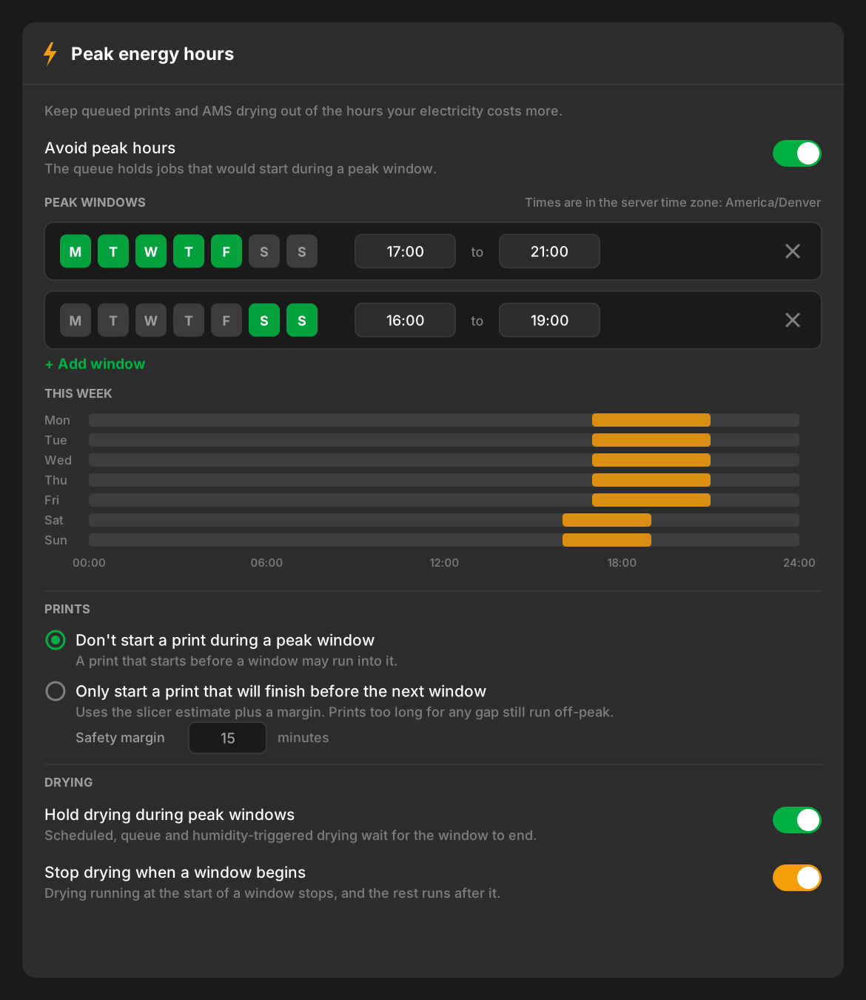
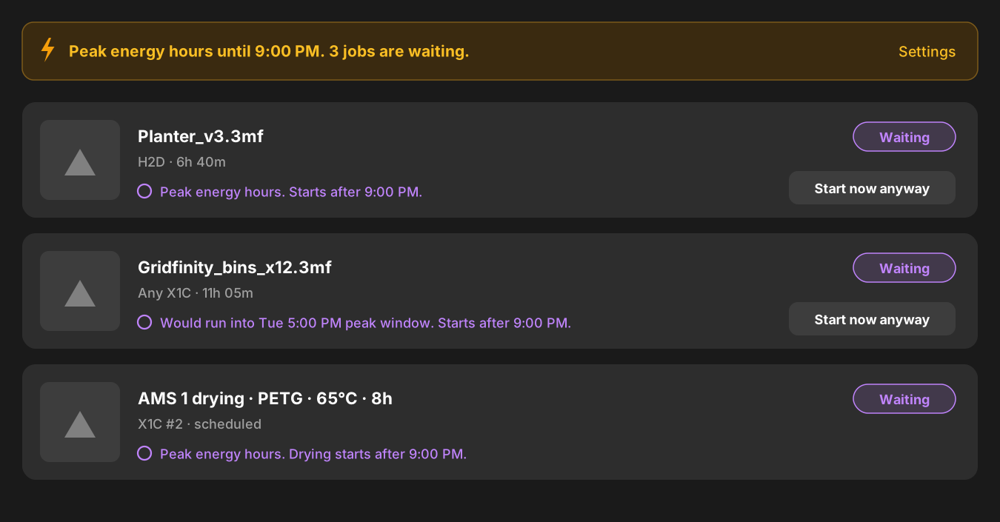
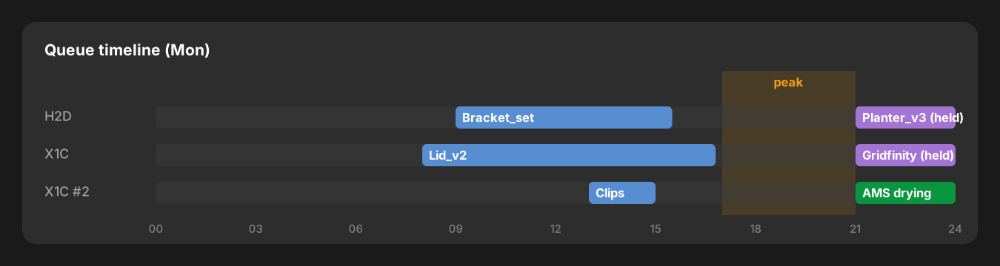

# Peak energy hours: keep the queue out of expensive electricity (#2639)

Status: **draft for maintainer review**. Nothing here is wired into the
scheduler yet; the branch carries only the pure decision core
(`backend/app/services/peak_energy.py`) with its unit tests, and static mockups.

## Problem

Many users pay time-of-use (TOU) electricity rates, for example 5-9 pm on
weekdays costs two to three times the off-peak price. Bambuddy can already hold
one job until a fixed time (`scheduled_time` on a queue item, `start_after` on a
scheduled drying run), but there is no way to say "never start jobs during these
hours on these days". Users either babysit the queue or schedule every job by
hand.

## Goals

1. Let a user describe their peak periods once: one or more weekly windows
   (days of the week plus a time range), in their local time.
2. The print queue does not **start** a print during a peak window. Optionally,
   it also holds a print whose slicer estimate says it would run **into** the
   next window, until a gap it fits into.
3. AMS drying (scheduled, queue auto-drying and humidity-triggered) does not
   start during a window, and can optionally be stopped when one begins and
   finished afterwards.
4. The user always sees why a job is waiting and until when, and can override
   it per job ("Start now anyway").
5. Off by default; with it off, nothing behaves differently.

## Non-goals (v1)

- **Pausing a running print at a window boundary.** On Bambu printers a paused
  print keeps the bed heated to hold adhesion, so a four-hour pause saves little
  energy, and resuming after hours risks layer lines, warping and lost
  adhesion. A started print always runs to completion. (Open question 3.)
- Holiday calendars or one-off exceptions. TOU plans often treat holidays as
  off-peak; v1 users can switch the feature off for the day.
- Different schedules per printer or per location. One schedule for the whole
  install. (Open question 4.)
- Choosing the cheapest slot from a price forecast. v1 is "avoid windows", not
  "optimise cost".
- Prints started outside the queue (from Bambu Studio, Handy, or the printer's
  screen). Bambuddy does not gate those today and won't start to.

## User stories

- *As a user on a weekday 5-9 pm TOU plan*, I queue three prints at 4:30 pm.
  The first one starts; the rest wait and start at 9:00 pm, one after another
  as printers free up.
- *As a user who also cares about running into peak*, I pick "only start prints
  that finish before the next window". A 6-hour print queued at 2 pm waits until
  9 pm instead of running 5-8 pm at peak price. A 30-hour print queued on Monday
  waits for the weekend gap. A 5-day print can never fit and simply starts
  outside a window.
- *As a user who dries filament overnight*, my 8-hour drying run scheduled for
  6 pm starts at 9 pm. A drying run in progress at 5 pm stops and the remaining
  hours run after 9 pm.
- *As a user in a hurry*, I press "Start now anyway" on a held job and it starts
  on the next scheduler pass.

## Behaviour

### Defining windows

A window is `{days, start, end}` where `days` are the weekdays the window
**starts** on, and `start`/`end` are wall-clock `HH:MM`.

- `end <= start` means the window ends the next day (22:00-06:00).
- `start == end` means a full 24 hours (an "all day Sunday" peak).
- Overlapping or back-to-back windows are merged, so 14:00-17:00 plus
  17:00-21:00 behaves as one 14:00-21:00 period.
- Windows are interpreted in the server's time zone (`TZ`, via
  `utils.local_time.local_zone()`), which is what the rest of Bambuddy already
  uses for calendar reasoning. The settings card shows the zone so a container
  without `TZ` (UTC) is obvious. (Open question 5.)
- DST: windows keep their wall-clock meaning. A 17:00 window is 17:00 local on
  both sides of a change. A window starting inside a spring-forward gap is
  shifted by the gap; an ambiguous fall-back time takes its first occurrence.
  Covered by tests.

### Starting a print

The scheduler already holds an item whose `scheduled_time` is in the future.
The peak check runs right after that check, before printer matching, for every
pending item that is not `manual_start` and not `ignore_peak_energy`:

| Policy | Rule |
|---|---|
| `start_outside` (default) | Hold if *now* is inside a window, until the window ends. |
| `finish_before` | Also hold if `now + estimate + margin` would reach the next window. Start at the first off-peak instant (now, or the end of a peak period) that leaves enough room before the following window. If no gap within the next 8 days is long enough, fall back to `start_outside`, so long prints are never stranded. |

- The estimate is `print_time_seconds`, already cached on the queue row for
  shortest-job-first. With no estimate, `finish_before` behaves like
  `start_outside`.
- `margin` (default 15 min) pads slicer optimism and the heat-up time.
- Model-targeted items ("any X1C") are checked before printer matching, so a
  held job never claims a printer.
- A held item gets `waiting_reason` set (see API) and is skipped, exactly like a
  future `scheduled_time`. It does not count as "jumped" for SJF starvation,
  because it was never dispatchable.
- `scheduled_time` and peak windows combine: the job starts at the later of
  the two.
- The check is re-evaluated every scheduler pass, so editing the windows or
  turning the feature off takes effect within one pass.

### Manual start and override

- `POST /queue/{id}/start` on a held item during a window answers `409` with
  `code=peak_energy` and the window's end time, the same pattern as the
  existing filament-deficit check. The UI then asks: **Start now anyway** or
  **Start after peak**. "Anyway" retries with `ignore_peak_energy=true`, which
  sets the item's new `ignore_peak_energy` flag; "after peak" just leaves it
  queued.
- Items created by an explicit "print now" action on the printer card
  (`cleanup_library_after_dispatch`) are created with `ignore_peak_energy=true`,
  because the user asked for that printer, now. (Open question 2.)
- Reprints and queue additions with "ASAP" are subject to the windows like any
  other queued job.

### A print running when a window begins

Nothing happens: it runs to completion (see non-goals). With `finish_before`
this only occurs when the estimate was wrong or the print was overridden.

### Drying

All three drying paths start the same way, through the scheduler:

- **Scheduled drying** (`_check_scheduled_dryings`): a due row in a window
  stays `pending` with `waiting_reason="peak_energy"`.
- **Queue auto-drying and ambient drying** (`_check_auto_drying`): no new cycle
  starts during a window.
- **Print + dry on supported models** (`print_drying_enabled`): same as above.

`peak_energy_stop_drying` (default on) stops a cycle Bambuddy started when a
window begins, using the existing stop command (`mode=0`):

- A scheduled run goes back to `pending` with `duration_hours` reduced to what
  is left (rounded up to the hour, the printer's unit) and `start_after` set to
  the window's end. One row, so the UI shows one job.
- An auto-drying cycle is simply stopped; the humidity trigger restarts it
  after the window if it is still needed.
- `spool_drying` stamps a spool as dried only when a cycle ran half its
  length. A split run can fail that test on both halves. The resumed run should
  carry the original length so the stamp is judged on the total. (Small change
  in `drying_record`, noted for implementation.)
- Drying a user started by hand on the printer is never stopped.

### Printer offline, restarts, clock changes

- The check is a pure function of the current time and settings; nothing is
  persisted about windows, so restarts and clock jumps need no recovery.
- An offline printer is unaffected: held jobs wait for both conditions.
- Smart plugs: a held job does not trigger auto power-on, because power-on
  happens at dispatch.

## Peak source: manual windows or Home Assistant

Bambuddy already reads an electricity price from Home Assistant (#1251,
`energy_price_source = "homeassistant"`), and many TOU users already have an
HA entity that tracks the tariff (a `utility_meter` select switching between
`peak` and `offpeak`, a `binary_sensor`, or a price sensor). So the feature
offers two sources:

| `peak_energy_source` | Peak means | Hold until |
|---|---|---|
| `windows` (default) | now is inside a configured window | the window's end (known) |
| `homeassistant` | the entity's state is one of `peak_energy_ha_states` (default `peak,on`) | the next pass where it isn't (unknown) |

Trade-off: HA tells us the state **now**, not the future. With the HA source,
`finish_before` is not available (we cannot know when the next window starts),
the queue shows "Peak energy hours (Home Assistant)" without an end time, and
the timeline cannot shade future windows. The entity is read at most once a
minute through the same HA client as the price source, and when HA is
unreachable the queue is **not** held (fail open, logged), so an HA outage
can't stall printing.

A price-threshold variant ("peak when the price sensor is above X") falls out of
the same code path and could follow later. (Open question 1.)

## Data model

Settings (key/value rows, like the existing drying and energy settings):

| Key | Type | Default |
|---|---|---|
| `peak_energy_enabled` | bool | `false` |
| `peak_energy_source` | `"windows" \| "homeassistant"` | `"windows"` |
| `peak_energy_windows` | JSON string, list of `{"days":[0-6], "start":"HH:MM", "end":"HH:MM"}` (0 = Monday) | `""` |
| `peak_energy_ha_entity` | str | `""` |
| `peak_energy_ha_states` | str, comma-separated | `"peak,on"` |
| `peak_energy_print_policy` | `"start_outside" \| "finish_before"` | `"start_outside"` |
| `peak_energy_margin_minutes` | int, 0-240 | `15` |
| `peak_energy_hold_drying` | bool | `true` |
| `peak_energy_stop_drying` | bool | `true` |

`peak_energy_windows` is validated on write in `AppSettingsUpdate` with
`parse_windows()`, which returns a 422-ready message for any malformed entry.
JSON in a string matches `drying_presets` and keeps the settings table flat.

New column on `print_queue`: `ignore_peak_energy BOOLEAN DEFAULT 0`, added in
`core/database.py` like `skip_filament_check`, and exposed on the queue item
create/update/response schemas.

No new table. No change to `scheduled_dryings`.

## API

- Settings: the keys above on the existing `GET`/`PATCH /settings`, behind the
  existing settings permission.
- `GET /peak-energy/status` (queue read permission):
  `{ "enabled", "source", "active": bool, "until": iso|null, "next_start": iso|null, "zone": "America/Denver" }`.
  Feeds the queue banner and the timeline shading without the frontend
  re-implementing the rules in TypeScript.
- `POST /queue/{id}/start?ignore_peak_energy=true`, and `409 {code: "peak_energy", until}`
  as described above. Queue update permissions apply as today.
- `waiting_reason`: the queue page currently shows this as raw text. For peak
  holds the scheduler writes a code, `peak_energy:<reason>:<iso until>`
  (`in_peak_window` or `would_overlap_peak`), and the frontend renders a
  translated, localised message. Scheduled drying already uses short codes.

## UI

### Settings: a "Peak energy hours" card next to "Auto-Drying"

- One toggle to enable, the server time zone shown next to the windows.
- Window rows with weekday chips and two 24-hour time inputs, `+ Add window`,
  and a week strip that draws the merged result, so an overnight window or an
  overlap is obvious at a glance.
- The print policy as two radios with the margin under the second.
- Two drying toggles.
- With the Home Assistant source (not drawn), the window editor is replaced by
  an entity picker and a "states that mean peak" field, and the
  "finish before" radio is disabled with a hint.

### Queue: why a job waits, and the override

- A banner while a window is active: "Peak energy hours until 9:00 PM. 3 jobs
  are waiting."
- Held jobs use the existing purple **Waiting** badge with a translated reason
  and time, and a **Start now anyway** button.
- Held scheduled drying runs show the same reason on their card.

### Timeline: shade the windows

`QueueTimelineView` shades peak periods from `/peak-energy/status` (or a
`/peak-energy/intervals?from&to` variant), so the user can see why a job's
projected start moved.

The mockups are hand-drawn in the app's dark-theme palette, not screenshots;
real screenshots go in the wiki PR with the implementation.

## Implementation plan

Small, reviewable PRs, each with tests and every locale updated:

1. **Decision core** (this branch): `services/peak_energy.py`, pure, typed,
   unit-tested. No behaviour change.
2. **Settings and print queue**: settings keys and validation, the
   `ignore_peak_energy` column, the scheduler hook after the
   `scheduled_time` check, the `/start` 409, `/peak-energy/status`, the settings
   card and the queue reason/banner/override.
3. **Drying**: hold and stop/resume for scheduled and auto drying, plus the
   `drying_record` length fix.
4. **Home Assistant source** and timeline shading.
5. Wiki pages (Queue, Settings, Drying) in `bambuddy-wiki`.

## Testing

- **Unit** (in this branch, 32 tests): window parsing and validation, merging,
  overnight and all-day windows, DST fall-back and spring-forward, both
  policies including the weekend gap, "too long for any gap" fallback, unknown
  estimates, drying start/stop.
- **Integration** (with PR 2-4): the scheduler against the SQLite test DB and
  the existing printer fakes, with the clock passed in: a held item gets the
  reason code and starts on the first pass after the window; `scheduled_time`
  later than the window wins; `ignore_peak_energy` bypasses; model-targeted
  items don't claim printers while held; a scheduled drying run is stopped and
  resumed with the remaining hours; disabling the feature releases everything
  on the next pass; HA unreachable fails open.
- **Frontend** (vitest): the window editor round-trips the JSON setting, the
  week strip renders overnight windows, the queue renders each reason code,
  and the 409 shows the confirm dialog.

## Open questions for the maintainer

1. **Home Assistant source in v1?** Manual windows cover most TOU plans and
   give end times. The HA source reuses #1251's client and suits users whose HA
   already tracks the tariff, but can't predict windows. Ship both, or windows
   first?
2. **Printer-card "print now"**: should it bypass peak windows (proposed), or
   ask like the queue's manual start does?
3. **Pausing running prints**: agreed to leave out? If wanted later, it should
   be per-printer opt-in, with a warning about adhesion.
4. **Per-printer or per-location schedules**: needed by anyone? The data model
   could later add an optional `printer_ids` list per window.
5. **Time zone**: use the server `TZ` (proposed, matches `local_time`), or add
   a setting like `finance_budget_reset_timezone`?
6. **Notifications**: should holding a job send one ("3 jobs held until
   9:00 PM"), or is the queue banner enough? Proposed: no notification in v1.
